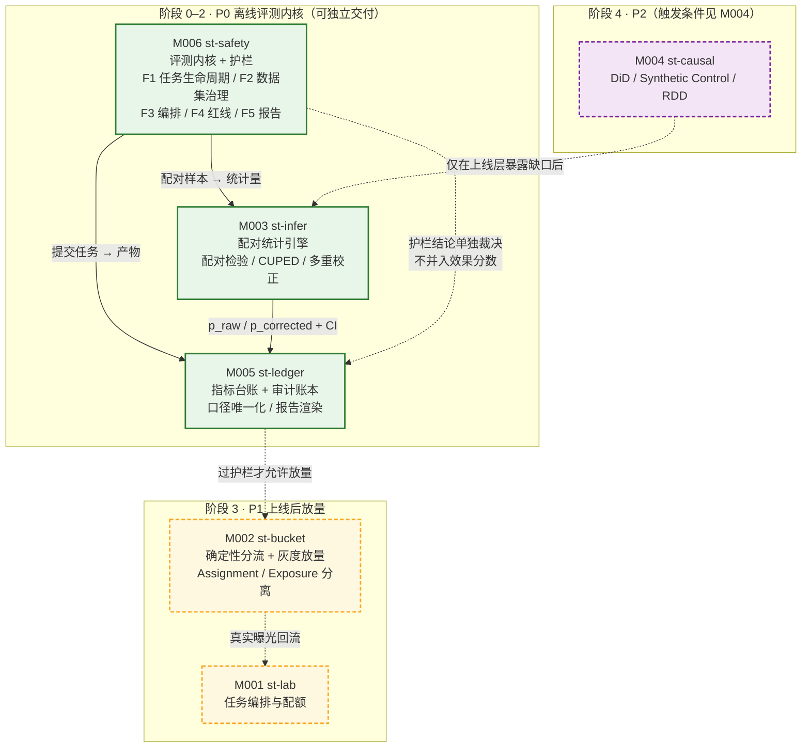
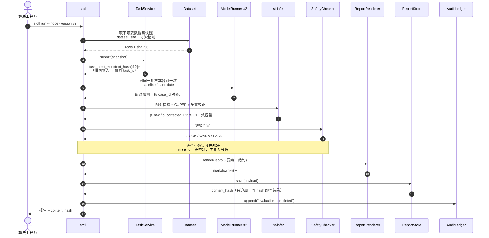
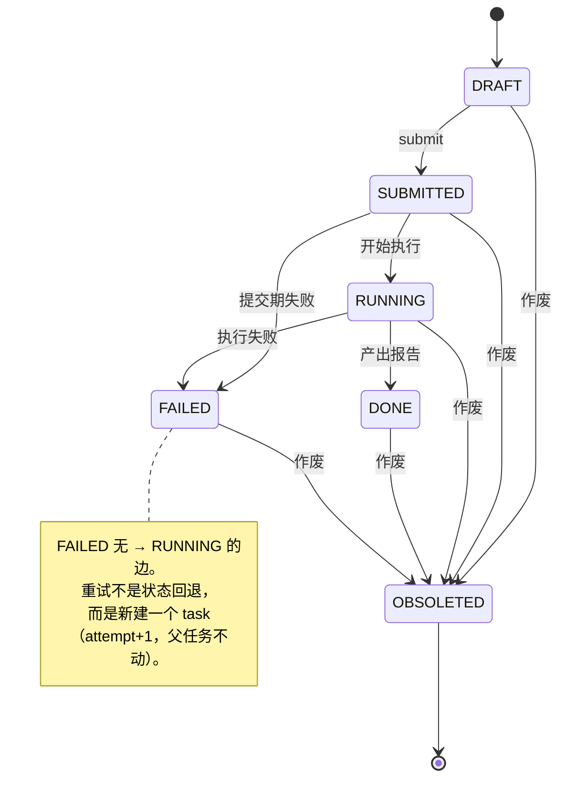
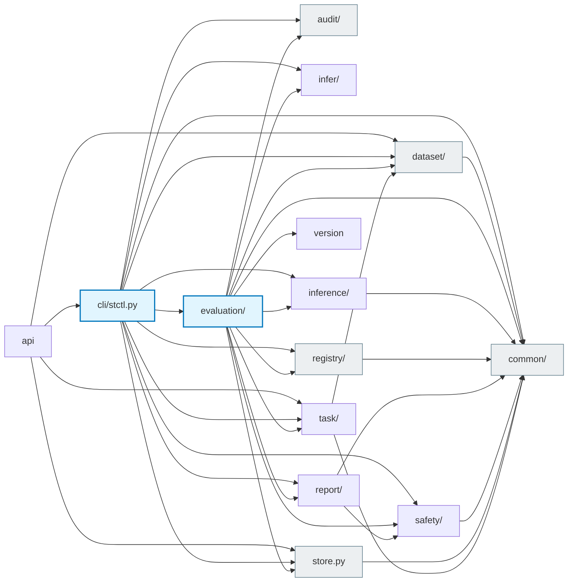

# SynthTrial 需求文档 v2.0

> Medical Model A/B Testing & Causal Inference Platform · codename `st-platform`
> 状态：**待评审** · 取代 v1.0（v1.0 的模块边界建立在错误的场景假设上，见 §0）
>
> **仓库尚为空。** 本文描述的是需求，不是实现。

---

## 0 · v1.0 错在哪（评审时请先看这里）

v1.0 通篇假设典型场景是**在线实时实验**。经确认，实际的第一批场景是：

> 算法工程师提交一个待上线模型版本 → 系统跑离线评测 → 生成护栏报告 → 决定能否放量

两者不是同一类软件。在离线评测内核下，v1.0 中**最大一块复杂度预算花错了位置**。逐条核对：

| v1.0 条目 | 在离线评测内核下的状态 |
|---|---|
| M001 实验状态机（草稿→灰度→全量→暂停/回滚→归档） | **暂停与回滚两个最贵的状态直接消失** —— 离线评测一次性跑完，没有「暂停后还要接着跑」的概念 |
| M002 千万级 QPS 分流 | **无对应需求** —— 批量任务不是在线分流服务 |
| M003 序贯检验 + 防偷看机制 | **无对应需求** —— 一次性跑完没有「中途偷看」的窗口 |
| M003 护栏异常 10s 内熔断 | **无对应需求** —— 熔断是实时服务的运行时行为，离线场景对应物是「批任务判定为不合格」 |
| M005 核心指标看板延迟 <5min | **无对应需求** —— 分钟级批量产出即可 |

**这些不是「可以简化」，是根本不存在该需求。照抄即造无人使用的复杂度。**

同时，v1.0 漏掉了离线评测真正的地基（详见 §3）。**优先级重排不足以修正 v1.0，模块边界必须重画。**

### 0.1 一个必须先承认的局限

离线评测原理上测不出三件事：**医生采纳率、诊疗行为的改变、远期健康结局**。它们只在一上线后的真实观测里才可测。

因此在线层（st-bucket / st-infer）是**长期必需，不是可选项**，只是不在第一期。v1.0 把这两件事混成一个模块，是错配的根源。

---

## 1 · 场景与用户

**唯一的第一场景**：算法工程师/评测工程师提交待上线模型版本，拿到一份可决策的护栏报告。

| 角色 | 要什么 | 在哪 |
|---|---|---|
| 算法工程师 | 这个版本能不能上？比线上版本好多少？差在哪个人群？ | 主 |
| 评测工程师 | 结论可信吗？口径对吗？能不能复现？ | 主 |
| 医疗安全 / 合规 | 有没有击穿安全底线？谁批的？留痕在哪？ | 审批方，非直接用户 |
| 业务方 | 什么时候能放量 | 间接受影响，第二期 |

**本期不服务的用户**：需要在线实时实验的业务方（M001–M003 的在线形态）。

---

## 2 · 范围

**做**（P0）：离线评测内核 + 护栏 + 可复现的统计结论
**做**（P1）：上线后灰度放量与在线验证（st-bucket / st-infer 在线形态）
**不做**：因果推断（st-causal，见 §6 理由）

---

## 3 · 模块需求

### M006 · st-safety · 医疗模型评测与安全护栏 —— **P0 内核**

内核模块。承载第 1 节的完整主流程。

**F1 评测任务生命周期**（取代 v1.0 的「实验状态机」）
- 任务状态机：`草稿 → 已提交 → 运行中 → 已完成 / 失败 / 已作废`
- 任务不可变：一旦提交，模型版本 + 数据集版本 + 参数被冻结为快照，中途不可改（这是 §3.5 可复现的前提）
- 失败可重试，但重试产生**新任务**，不覆盖旧任务（保证审计链完整）
- 已完成任务**不可删除**，只可作废（作废需填原因）

**F2 评测数据集管理**（v1.0 完全缺失 —— 离线评测的地基）
- 数据集注册：来源、标注规范、标注者、标注一致性（Cohen's κ / Krippendorff's α）
- 数据集版本化，不可变
- **污染检测**：数据集与模型训练语料的重叠检测（按病例 ID、时间窗、文本指纹三条策略）
- 分层抽样能力：按科室 / 病种 / 年龄段 / 性别切分子集

**F3 评测任务编排**
- 批量推理调度，对接模型推理服务（多版本）
- 断点续跑、失败重试、资源配额
- **同一批样本跑新旧两个模型**（配对，见 §4）

**F4 护栏检查**
- 安全红线清单（可配置，随合规要求更新）
- 分级：`阻断`（不可上线）/ `告警`（需审批）/ `提示`
- 阻断项命中即判定不合格

**F5 评测报告**
- 分维度指标 + 统计显著性 + 置信区间
- 护栏结论（阻断/告警/提示 三色）
- **可复现元信息**（模型版本、数据集版本、评测代码版本、随机种子）
- 导出（PDF / Markdown）+ 归档

**验收标准**
- 报告必须能回答 F5 的可复现元信息全部五项，缺一即判定报告无效
- 污染检测：注入已知重叠样本，检测必须命中（阻断，不得静默通过）
- 标注一致性 κ < 阈值的子集，在报告中显式标注为「结论仅供参考」
- 端到端（提交 → 报告）：单任务 < 4h（TB 级扫描，非单请求延迟）

---

### M003 · st-infer · 统计与显著性 —— **P0**

**核心前提：离线评测的对照组天然存在。** 同一批样本跑新旧两个模型 = **配对设计（paired design）**，是统计上最干净、方差最小的情形。这一点决定了本模块与 v1.0 的形态完全不同。

**F1 配对检验**
- 连续型指标：配对 t 检验 / Wilcoxon 符号秩检验
- 二分类指标：McNemar 检验（配对二分类的正确检验，不是卡方）
- 效应量：相对提升率 + **绝对提升率**（医疗场景绝对提升率才是决策依据）

**F2 方差缩减**
- CUPED：利用**同一患者的历史指标**（前次评测得分、上次就诊记录中的可用代理量）作为协变量
- 协变量缺失时的降级策略需显式声明

**F3 多重比较校正 —— 必需，不是可选项**
- 指标数 × 子组数在医疗场景下极易膨胀（10 指标 × 8 子组 = 80 次检验）
- Bonferroni（FDR/BH 作为宽松档提供）
- **报告必须显示校正前与校正后的显著性，并只以校正后为准**

**F4 结果可解释**
- 置信区间（95%）
- 效应量 + 区间，不只报 p 值

**验收标准**
- 统计计算耗时 < 3s（单实验全量指标，报告口径）
- 校正前后显著性必须同时出现在报告中（缺一即不合格）
- 子组分析必须强制走多重比较校正（无法绕过）
- p 值不得单独作为报告结论呈现

---

### M005 · st-ledger · 指标台账与口径 —— **P0**

**F1 指标注册表**：统一定义一次，全局引用，禁止各处硬编码口径
**F2 医疗专用指标**：准确率、召回率、敏感度/特异度、**诊断一致性**、**诊疗合规性**（须由合规/医学专家定义，不归算法团队定义）
**F3 报告渲染**：分维度指标、趋势、子组拆解
**F4 审计台账**：谁在何时提交了什么、谁批的、结论是什么，全留存不可删

**验收标准**
- 报告生成 < 10s
- 任一报告中的每个数字可反查到注册表 ID + 版本
- 审计台账追加写，任何角色无删除权限

---

### M001 · st-lab · 任务编排与生命周期 —— **P1**

> **命名冲突待裁定**：v1.0 约定中 M001 无代号，我暂定 `st-lab`。且 M003 的 `st-infer` 与 M004 的 `st-causal` 语义重叠（见 §6）—— `infer` 指向推断，实际混淆了统计检验与因果推断。

**F1 任务队列与优先级**、**F2 配额与成本控制**、**F3 结果归档与检索**

**（v1.0 的正交实验、多层实验架构归入 P1 的在线实验形态，见 §5）**

---

### M002 · st-bucket · 分流与放量 —— **P1**

**F1 确定性分桶**：MurmurHash(UserID/DeviceID + ExpID)
**F2 一致性保证**：同用户周期内始终命中同组，跨地域双活一致
**F3 精细化定向**：地域、设备、医疗画像标签
**F4 灰度放量**：10% → 50% → 100% 动态调整
**F5 互斥组与 Holdout**

**F6 Assignment 与 Exposure 分离**（最高优先级的一条，见 §4.3）

**验收标准**：分流一致性 100%（跨地域双活验证）；放量调整生效 < 1s

---

### M004 · st-causal · 因果推断 —— **本期不做（移入 P2）**

v1.0 给了 P1 并列的位置。在离线评测内核下它**没有需求来源**：离线评测的对照组是天然存在的（跑一遍旧模型），不需要构造准实验对照组。

**保留它的唯一理由**：离线评测原理上测不出医生采纳率与远期健康结局（§0.1），这些只能靠观测数据上的因果推断来估。若 P1 阶段验证了这一缺口，则因果推断升为 P1。

**候选算法**（届时再评估）：DiD（含平行趋势检验）、Synthetic Control、RDD、PSM/IV、ITS

---

## 4 · 全局约束

### 4.1 报告可信度铁律

**一份不能回答「这个分数怎么来的」的报告，不构成决策依据。**

每份报告必须携带：模型版本 · 数据集版本 · 评测代码版本 · 随机种子 · 数据污染检测结论。

### 4.2 护栏先于效果

一个统计显著的收益**不构成**上线理由；一个安全红线被击穿则**一票否决**。护栏与效果指标在报告中不合并为单一分数，护栏独立给出三色结论。

### 4.3 曝光缺口（在线期 P1 的最高优先级）

**分配 ≠ 曝光。** 用户被分到 B 组（Assignment）与 B 组结果真的影响了决策（Exposure）是两件事，中间隔着「拿到了没」和「拿到了用没用」。

漏记一条 Exposure，该实验结论不可信，且**不会报错**，只会让结论悄悄失真。分流日志与曝光日志分开落，结论计算只用 Exposure。

### 4.4 不可见 ≠ 未曝光

离线侧的同族问题：模型在评测集上高分，不代表这些样本未参与训练。**污染检测与曝光日志分离是同一条铁律的两个方向**，都必须有独立机制。

---

## 5 · 非目标（明确不做）

- **不做在线实时实验平台**（P1 之前）—— 无业务驱动
- **不做正交实验/多层实验架构**（P1 之前）—— 服务于在线实验形态
- **不做通用 BI**——只做评测报告，不做业务看板
- **不做因果推断**（P2，见 §3 M004）
- **不做模型训练/调参平台**——只做评测

---

## 6 · 非功能需求

| 维度 | 要求 | 说明 |
|---|---|---|
| 性能 | 端到端单任务 < 4h；统计计算 < 3s；报告生成 < 10s | **无 QPS 指标** —— 离线批任务形态，v1.0 的「千万级 QPS」不适用于本平台 |
| 可靠性 | 任务不丢不重；失败可重试；结果不可变 | 不承诺「分流服务 99.99%」（在线期 P1 才需要） |
| 可扩展 | 单集群 TB 级/天横向扩展 | — |
| 安全合规 | 患者数据脱敏；审计台账不可删；报告访问受控 | 见 §4.4 与 §7 |
| **可复现** | 报告五要素齐全（§4.1） | **本平台第一非功能指标** |

---

## 7 · 指标可测性规范（强制）

每条验收标准必须能写成 `给定 X，断言 Y，阈值 Z` 的可执行测试。写不出来的按下表降级：

| v1.0 原文 | 降级为可承诺 SLO |
|---|---|
| 「安全护栏零漏报」 | 「已登记红线集 R 的召回率 = 100%；R 之外标记为未覆盖，未覆盖样本数与占比逐任务可审计并随报告输出」 |
| 「分流一致性 100%」 | 「同一 (业务线, 用户ID, 实验ID, 时间窗) 在跨地域双活节点下决策相同」，并给出验证方法 |
| 「统计计算 <3s」 | 声明 P99、声明测试数据量级 |
| 「样本量预估误差 <10%」 | 声明依赖「基线转化率估计误差 < X%」，否则不可验收 |
| 「准确率提升」类 | 必须同时给出绝对提升率与 95% CI，仅给相对提升率不可验收 |

---

## 8 · 技术约束

- 后端 Python（首选）；Go 备选
- 测试工程化，评测平台化
- 大规模离线/实时计算；因果推断算法库集成（后置）

---

## 9 · 待决事项

| # | 问题 | 影响 | 我的倾向 |
|---|---|---|---|
| Q1 | M001 代号 | 命名一致性 | `st-lab` |
| Q2 | `st-infer` 与 `st-causal` 语义撞车 | 名字即文档，撞车持续误导 | M003 改 `st-stats`；**但这是你给的约定，等你裁决** |
| Q3 | ~~首批使用者是谁~~ | ~~整份 PRD 骨架~~ | ✅ **已结案：离线评测 + 护栏为内核**（2026-10-16） |
| Q4 | 标注一致性 κ 的可接受阈值 | 决定 M006 F2 与结论效力声明 | 需医学/合规方给值，我不拍 |
| Q5 | 护栏红线清单 R 的内容与更新机制 | 决定 F4 的召回率定义 | 需合规方给值，我不拍 |
| Q6 | 是否需要新旧模型**同时在线**（影子模式）后再进评测 | 影响 M002 是否要提前到 P0 | 倾向 P1 引入 |

---

## 10 · 交付顺序建议

```text
阶段 0  指标注册表 + 数据集治理 + 可复现元信息   ← 地基，无此则后续结论全不可信
阶段 1  评测任务编排 + 配对统计（含 CUPED/多重校正）
阶段 2  护栏 + 报告 + 审计台账                  ← 第一份可用报告
────── 以上为 P0，可独立交付价值 ──────
阶段 3  st-bucket 灰度放量 + st-infer 在线验证   ← P1
阶段 4  st-causal 因果推断                       ← P2，触发条件见 M004
```

**阶段 0–2 不依赖任何在线实验能力**，可独立立项、独立交付。这是与 v1.0 最大的结构差异：**P0 阶段完全不碰分流服务**。

---

## 11 · 组件关系图

> 以下四张图分别回答四个不同问题：**谁负责什么**、**一次评测怎么流动**、**任务状态怎么变**、**代码实际怎么依赖**。
> 前三张是设计意图，第四张由 `src/` 实际 import 生成，两者冲突时以第四张为准。

### 11.1 组件职责与分期



**读图要点：** 实线 = P0 内部已实现的数据流；虚线 = 后续阶段或非数据依赖。
P0 三个模块之间的数据流（实线）不涉及 `st-bucket` —— 这正是 §0 判据二的图形表达；`st-bucket` 仅出现在 P1 子图中。

### 11.2 一次 P0 评测的端到端数据流



**失败路径：** 任一环节抛错 → 任务转 `FAILED`，**不覆盖**；重试生成**新 task_id**（`#r<n>`），
因此历史结论永远可回溯（见 §11.3 与 AGENTS.md D-3）。

### 11.3 任务状态机



**为什么没有 `FAILED → RUNNING`：** 这是本平台最重要的一条不变量。
若允许回退，重试会覆盖已完结任务的产物，审计链断在最容易断的地方 —— 失败之后。
已完结任务**只可作废，不可删除**（AGENTS.md D-3、D-5）。

### 11.4 代码实际依赖方向（由 `src/` 的 import 生成）

> ⚙️ **本图由 `python3 tools/gen_dep_graph.py` 生成，请勿手改。**
> `python3 tools/gen_dep_graph.py --check` 在图与真实 import 不一致时 exit 1，
> 可直接挂进 CI。手绘图会静默漂移：代码改动之后它看上去依然自洽。



**方向规则（评审用）：**

| 规则 | 判据 |
|---|---|
| `common/` 不得 import 任何 `st_platform.*` | 它是所有模块的地基，出现反向依赖即架构腐化 |
| `dataset/` 不得 import `task/`、`infer/`、`safety/` | 数据治理不认识评测语义 |
| `safety/` 不得 import `infer/` | 护栏必须能独立于统计引擎裁决，否则效果分能反向影响护栏 |
| `report/` 可读 `safety/`（渲染 verdict），但 `safety/` 不可读 `report/` | 单向，避免循环依赖 |
| `cli/` 与 `evaluation/` 是编排层，可依赖其余全部 | 唯一的「什么都认识」的位置（`evaluation/` 待合并后校验） |

`evaluation/`（P0 管线）与 `cli/` 同属编排层：这是 11.2 数据流在代码里的落点。

### 11.5 图与代码的一致性维护

新增/删除模块后必须同步的三处（漂移即缺陷）：

1. 本节 11.1 的组件图 —— 缺一个模块，评审会按错的骨架规划
2. 本节 11.4 的依赖图 —— 由 `grep -rn "^from st_platform\." src/` 重新生成
3. `docs/ARCHITECTURE.md` §1 的包表与 §5 的 gap 列表

> 判据：**图不是插画，是可执行的依赖契约。** 若 `grep` 的结果与 11.4 不符，
> 以 `grep` 为准并修正本图 —— 图错了比缺图更危险，因为它看起来仍然自洽。
>
> ⚠️ `evaluation/` 节点标注为「合并中」，因为在本次编写时它尚未合入 `main`。
> 这条规则本身就是 playbook 第 12 行的教训：**并行开发会让图立刻过期**，
> 所以尚未落地的组件必须显式标注，而不是先画成已完成再补一句说明。
